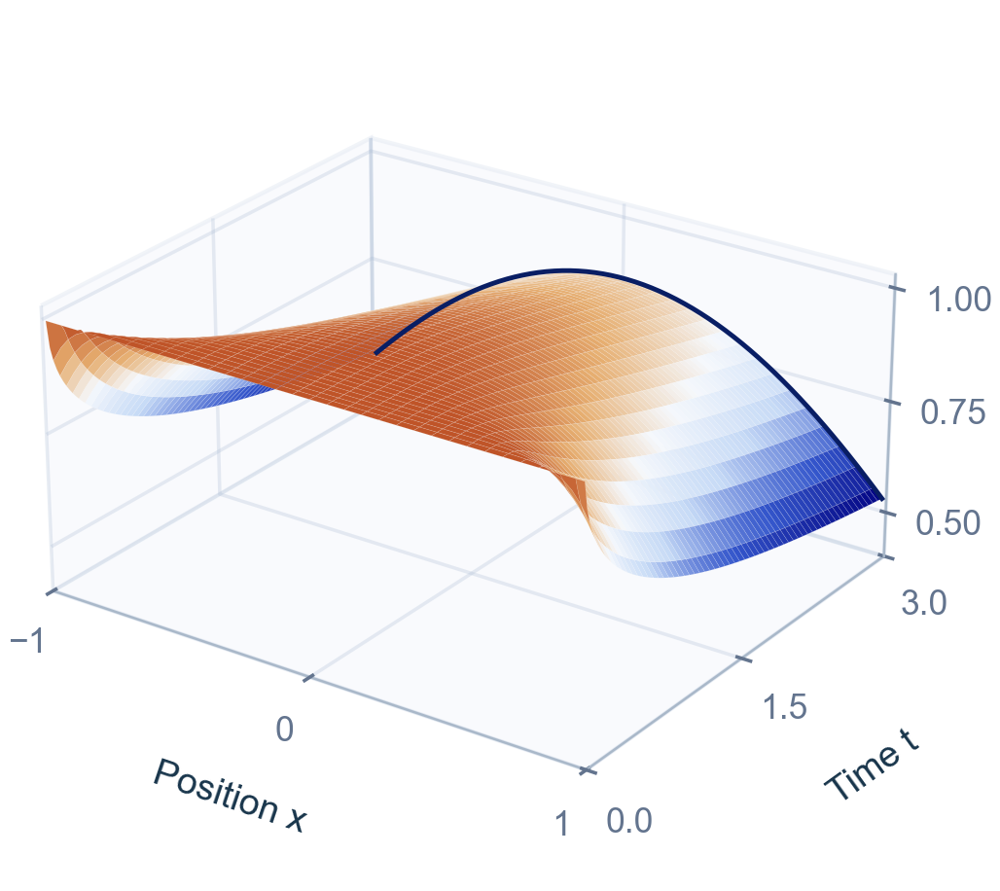
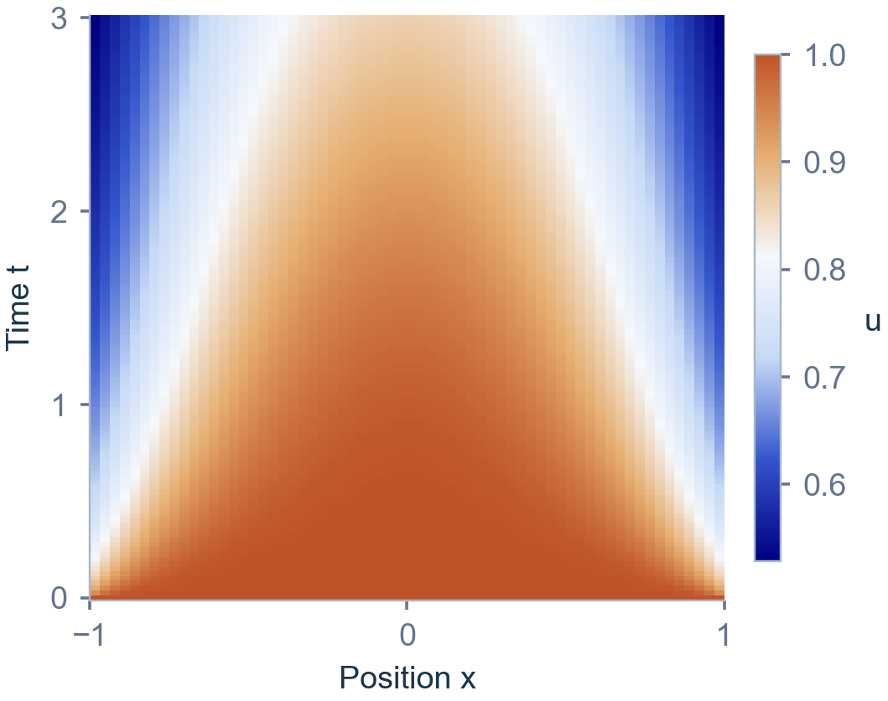
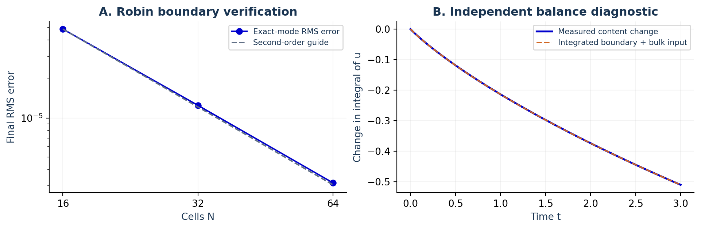

# PhaseAtlas

An interactive PDE research workspace for editing models, visualizing their evolution and checking numerical accuracy. Researchers and instructors can study heat transfer, nonlinear waves and reaction–diffusion systems, compare experiments and export reusable calculations.

**Niu Te · Imperial College London**

[Live website](https://phaseatlas.onrender.com/) · [PDE Studio](https://phaseatlas.onrender.com/studio.html) · [Research Workbench](https://phaseatlas.onrender.com/workbench.html) · [One-page PDF](https://phaseatlas.onrender.com/submission-2026/PhaseAtlas_One_Page.pdf) · [Video demonstration — 3:58](https://youtu.be/dlfz2zcyLTs)

| 3D space-time surface | Space-time heatmap |
| --- | --- |
|  |  |

## Run locally

Requirements: **Python 3.10+** and a modern browser. The local website uses the Python standard library and needs no package installation.

```bash
git clone https://github.com/NIU-55383/PhaseAtlas.git
cd PhaseAtlas
python launch.py
```

The launcher serves `dist/` and opens the local URL, normally `http://127.0.0.1:8765/`. It tries subsequent ports if that port is occupied. On Windows, double-clicking `START_PhaseAtlas.cmd` does the same thing.

To choose a port without opening a browser:

```bash
python launch.py --port 9000 --no-browser
```

Use the printed HTTP address so JavaScript modules and Web Workers load correctly. Chrome or Edge supports the WebM animation export.

## Try an experiment

1. Open **PDE Studio** and select **Convection-cooled rod · Robin**. For the illustrated case, use 64 cells, final time 3, time step 0.001 and 121 saved frames.
2. Run the model. Play or scrub the temperature profiles, inspect the heatmap, then rotate the **3D space-time surface**. Its axes are position, saved time and field amplitude.
3. Use **Check resolution** to compare time steps and spatial grids separately. Export the configuration and trajectory to retain the equation, boundary data, parameters and numerical settings.
4. In **Research Workbench**, inspect derived observables such as `-nu*Dx(u,1)` for heat flux, place virtual probes, compare parameter runs and inspect boundary-balance diagnostics.

The [Studio guide](docs/CUSTOM_PDE_STUDIO.md) gives expression syntax, boundary conventions, editable examples and backend restrictions.

## Models and methods

The Studio supports **one to three real fields** on intervals and rectangular domains.

| Model family | Domain and boundary data | Numerical method |
| --- | --- | --- |
| Periodic evolution equations | 1D intervals or 2D rectangles; spatial derivatives through total order four | Fourier differentiation and ETDRK4 for extracted diagonal linear terms |
| Diffusion, reaction and supported smooth transport | 1D/2D bounded domains; Dirichlet, Neumann or passive Robin conditions per field and edge | Cell-centered finite volumes with SBDF2; constant non-negative diagonal diffusion |
| Supported fourth-order equations | 1D intervals; two independent configurable linear conditions at each endpoint | Banded implicit SBDF2 solves with boundary reconstruction; negative constant diagonal fourth-derivative coefficient |

Fourth-order boundary rows can combine field value, outward slope, curvature and third outward derivative with user-defined target formulas. Presets include heat diffusion, viscous Burgers, KdV, Kuramoto–Sivashinsky, Allen–Cahn, Gray–Scott, Cahn–Hilliard and fourth-order travelling fronts.

Animations, fixed-scale heatmaps, 3D surfaces, reference differences, user-defined observables, virtual probes, parameter scans and refinement comparisons use computed trajectories. The 1D space-time surface supports rotation, playback, progressive reveal and PNG export. Display sampling leaves the full saved arrays intact. JSON/CSV exports retain numerical data; SVG/PNG and WebM exports support figures and presentations.

Supported geometries are intervals and rectangles. For bounded domains, variable/nonlinear diffusion and cross-diffusion require additional backends. Irregular geometries and 2D nonperiodic fourth-order problems are outside the current scope. Periodic terms left outside the diagonal linear operator are treated explicitly and can impose time-step restrictions. Reference comparisons and refinement provide numerical evidence whose interpretation depends on the model, grid, time step and boundary data.

## Verification and recorded results

The current mathematical and numerical suite contains **96 tests, all passing**. It checks expression parsing, exact/manufactured solutions, boundary enforcement, refinement, observables, conservation diagnostics and surface coordinates.

With Node.js installed, run the complete suite from the repository root. This command needs no npm dependencies:

```bash
node --test tests/science.test.mjs tests/studio.test.mjs tests/boundaries.test.mjs tests/fourth.test.mjs tests/evidence.test.mjs tests/research.test.mjs tests/robin.test.mjs tests/spacetime.test.mjs
```

`npm test` runs the same suite when npm is available. The suite was checked with Node.js 24.19.0.

The recorded Robin eigenmode benchmark uses 16, 32 and 64 cells at a fixed time step of 0.0002. Final RMS errors against the exact mode are approximately `4.86e-5`, `1.25e-5` and `3.15e-6`; adjacent-grid comparisons give an observed spatial order of **1.99995**. A separate 16-run cooling scan compares diffusivity and surface exchange. These measurements are stored in [case data](dist/data/submission-2026/) and the [submission manifest](dist/submission-2026/manifest.json).



## Reproduce the figures and summary

Install the optional scientific and document-generation dependencies:

```bash
python -m pip install -r research/requirements.txt
python -m pip install matplotlib reportlab pypdf pillow
```

The following commands regenerate the stored case arrays, scientific figures and current one-page PDF:

```bash
node research/build_submission_cases.mjs
python research/submission_figures.py
python research/submission_visuals.py
python research/build_submission_one_page.py
```

Outputs are written to `dist/data/submission-2026/` and `dist/submission-2026/`. The PDF builder uses Windows Arial font paths; adjust its font registration for another operating system. The committed PDF and figures can be viewed directly on any platform.

For an independent small-grid NumPy/SciPy reference calculation:

```bash
python research/studio_reference.py dist/data/submission-2026/reference/robin-mode-input.json --output robin-reference-check.json
```

The reference uses independently assembled spatial operators and SciPy time integration. Further benchmarks and measured limitations are documented in the [Studio guide](docs/CUSTOM_PDE_STUDIO.md) and [research notes](docs/RESEARCH_NOTES.md).

## Optional web deployment

The Flask application serves `dist/` and exposes `/healthz`. Scientific evolution runs in browser workers. For a Linux Python Web Service, install the root requirements and start:

```bash
pip install -r requirements.txt
gunicorn app:app --bind 0.0.0.0:$PORT --workers 1 --threads 4 --access-logfile - --error-logfile -
```

See [deployment instructions](docs/DEPLOYMENT.md) for the Render dashboard settings. Continue using `python launch.py` for the standard-library local preview.

## Project history and development

The numerical backends and benchmark arrays were developed before the hackathon. The event submission presents the integrated research workflow, updated scientific figures and documented 3D and flux-probe demonstrations. Saved records retain their generation dates and source hashes.

OpenAI Codex assisted implementation, debugging, verification scripts, documentation and presentation assets. Experiments run through deterministic numerical procedures in browser workers and require no model-service account or API key.
